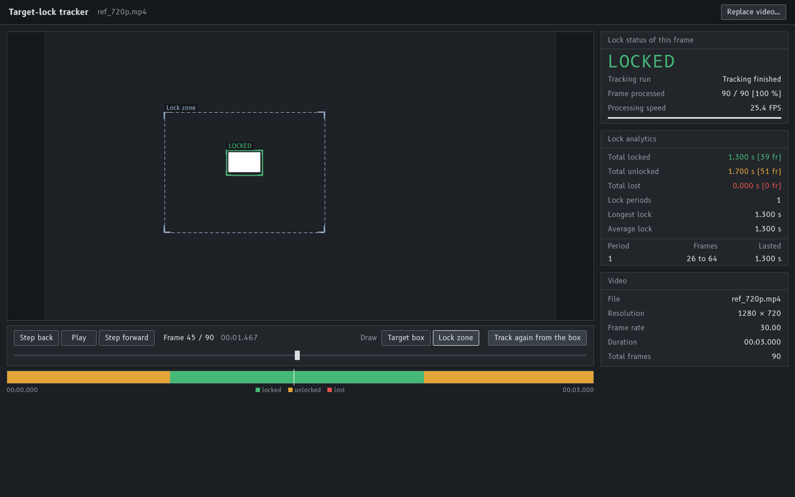

# Target-Lock Video Tracker

KUAVA Newcomer Task, Project B. A local web application that follows a target in drone video with an OpenCV tracker and measures how long the target stays inside a lock zone.



## Run it

You need **Python 3.10 or newer** and **Node.js 18 or newer**.

```
python run.py
```

The first run creates `.venv/`, installs the Python and Node packages, builds the page and opens http://127.0.0.1:8000. Later runs start at once. `Ctrl+C` stops it.

## Test it

```
python run.py test
```

This runs the three test suites and prints one result line for each:

| Suite | What it covers | Size |
|---|---|---|
| Backend (pytest) | Upload rules, frame access, lock logic, tracking, loss and resume | 246 tests |
| Page logic (Vitest) | Number formats, time-to-frame mapping, box drawing, step and upload decisions | 68 tests |
| Browser (Playwright, Chromium) | The console driven end to end against the real application | 14 tests |

The browser suite downloads Chromium on first use; without it those tests are skipped with a message. `python run.py test --slow` adds three tests that write real 1 GB files to a temporary folder.

## Use it

1. **Open video.** Choose an MP4 file. If it breaks a rule, every problem is listed with the value found and the value allowed.
2. **Look around.** Step one frame at a time, drag the slider, or play. When stopped, the picture is the exact frame the tracker sees.
3. **Draw the target box** around the target on the frame shown. Drag inside the box to move it, or a corner to resize it.
4. **Draw the lock zone** after choosing "Lock zone".
5. **Start tracking.** Progress and processing speed are shown while it runs.
6. **Read the result.** The timeline under the picture shows locked (green), unlocked (amber) and lost (red) stretches; the panels on the right give the totals, each lock period, and the status of the frame on screen.
7. **If tracking is lost,** the page goes to that frame. Draw a new box there, or on a later frame, and resume.

## What a video must be

| Rule | Value |
|---|---|
| Container and codec | MP4, QuickTime or 3GP with H.264 video, 8-bit colour, 4:2:0. The file name plays no part. |
| Size | at most 1,073,741,824 bytes (1 GB) |
| Picture | at most 921,600 pixels per frame (for example 1280 × 720); landscape or square |
| Length | at least 2 frames; no maximum |
| Rotation note | none (videos saved "turn when showing" are refused) |
| Tracks | one picture track; sound and data tracks are ignored |
| Frame rate | variable frame rate is accepted with a warning; times are then approximate |

Tracking is lost when the tracker reports failure, or when the box area changes by more than 50 % between two frames. A frame is LOCKED when the whole box is inside the lock zone; touching the edge counts as inside.

## How it is built

- `backend/` — Python, FastAPI, OpenCV, NumPy. `app/mp4probe.py` reads the video's index without decoding; `app/validation.py` holds the rules; `app/frames.py` serves exact frames; `app/tracking.py` runs the CSRT tracker in the background; `app/lock_logic.py` is the pure lock, period and analytics logic.
- `frontend/` — React, TypeScript, Tailwind CSS, Vite. The browser's video player plays the original file; a canvas draws the boxes over it.
- `e2e/` — browser tests.
- `backend/tests/fixtures/` — 51 generated test videos (2.5 MB in total, the largest 1.3 MB) and the script that rebuilds them with ffmpeg. Running the tests does not need ffmpeg.
- Uploaded videos go to `data/`, which Git ignores, and are removed when replaced or at start-up.

## How it was made, and what is still the operator's to do

The project follows the agentic skill pipeline in `.claude/skills/`: requirements, architecture, then test-first implementation, one branch per story.

| Document | Content |
|---|---|
| `docs/design/DESIGN.md`, `DESIGN_e64c4e2.md` | User stories, Gherkin acceptance criteria, Open Questions |
| `docs/architecture/ARCHITECTURE.md`, `ARCHITECTURE_e64c4e2.md` | Data models, decision tables, architecture questions |
| `docs/implementation/IMPLEMENTATION_LOG.md` | One entry per pass: red and green results, coverage, deviations |
| `docs/APPROVAL_LOG.md` | The approval entries |
| `LEARNING.md` | Open Questions the operator could not answer at first |

Read these facts before relying on the documents:

- The operator answered the Open Questions of Feature 1's requirements (OQ-1 to OQ-19); seven of those were handed to the agent and are marked as delegated.
- From then on the operator instructed the agent to finish without stopping at the approval gates. All later questions (OQ-20 to OQ-35, AQ-1 to AQ-17, IQ-1 to IQ-13) were **decided by the agent** and are marked so, each with its reason.
- **No approval entry is signed.** "Approved By" and "Approval Date" are blank for the operator.
- Branches were merged locally with merge commits; no pull requests exist.
- `LEARNING.md` lists the questions; the operator's own words are still to be written.

## Known limits

- Fragmented (streaming-layout) MP4 files are refused.
- A cover picture stored in a file's tags is ignored; a preview picture stored as a second picture track makes the file refused.
- `run.py` was exercised on Linux only.
- Playback needs a browser that plays H.264 (Chrome, Edge, Safari, Firefox).
